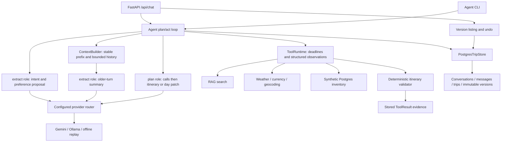

# Agent architecture

`POST /api/chat` and `python -m backend.agent.cli` use the same bounded agent loop and Postgres state store. The in-memory implementation remains available for isolated tests. No live fixture recording is part of either entry point.



## Turn lifecycle and grounding

1. Load the trip, confirmed preferences, prior messages and version history. A new request without `trip_id` creates a conversation; the response returns its ID.
2. Reject recognized sensitive input before storing its text or sending it to a provider. Classify the intent with the configured `extract` role. A preference proposal remains pending until the user sends exactly `confirm preferences` (case-insensitive). Proposals are complete preference replacements; inspect the returned object before confirming.
3. Assemble the static system prompt and tool definitions, preferences, current itinerary, recent messages and older-turn summary. Run plan/act for at most eight planning responses, configured in `config/models.yaml`.
4. Execute up to eight concrete independent calls together with `asyncio.gather`. Calls requiring a prior result must appear in a later batch. The runtime provides individual deadlines; exceptions become structured observations. Tool allowlists are enforced per intent, not merely described in the prompt.
5. Request `Itinerary` JSON, or a single-day `DayPatch` for edits. Configured structured output is used where supported; other providers receive a JSON schema instruction and their responses are validated locally. Provider routing and model IDs remain in configuration.
6. Check conversation ownership of result IDs and citation IDs, then run `validate_itinerary` against the trusted result ledger. Invalid candidates receive issue feedback for at most two repairs after the initial candidate. Schema-valid output alone cannot bypass the deterministic validator.
7. Accept a valid candidate atomically. If all remaining errors are budget errors, return the cheapest otherwise-valid candidate produced during these attempts with `budget_met=false` and an explicit explanation. This is not a global optimization guarantee. Other failures preserve the previous itinerary. Unpriced items yield `budget_met=null`; they are not treated as free.

Final messages are server-generated. They do not repeat unvalidated model prose. A `no_data` result always adds an explicit “cannot find” message. Prices remain typed itinerary costs validated against ToolResults. Place/category fields reject monetary/availability assertions; this is a conservative lexical guard. Inventory quotes are explicitly synthetic and cannot prove booking availability. Questions return the saved validated itinerary and retrieved observations, not an unrestricted prose answer.

Tool observations and retrieved text are serialized inside escaped `<DATA>` delimiters. Delimiters are a boundary convention, not a complete prompt-injection defense. Tool permissions and final validation remain code checks.

## Persistence and editing

`TripStore` defines create/load/save/versions/undo. `PostgresTripStore` uses four tables added by `20261103_agent_state`: `agent_conversations`, `agent_messages`, `agent_trips`, and `agent_itinerary_versions`. Confirmed preferences are Pydantic-validated JSON. Messages are append-only; itinerary changes, budget changes and undo append versions. An optimistic revision check rejects stale writes with HTTP 409 instead of losing concurrent edits. Tool calls performed by a stale turn may already have completed; the state write is what is atomic.

`replace_item`, `remove_item`, and `add_item` operate only on the classified one-based day. Other days are deep-copied and compared by serialized bytes before acceptance. Patches are revalidated against the entire trip, including total cost. Undo restores the parent itinerary/budget and appends a new version; it does not erase audit history or undo confirmed preferences.

- `POST /api/chat`: `{ "trip_id": "optional existing UUID", "message": "..." }`
- `GET /api/trips/{id}/versions`: immutable version objects, including itinerary and budget.
- `POST /api/trips/{id}/undo`: restored itinerary and new version number; HTTP 409 if no prior version exists.

The response includes `trip_id`, `message`, `itinerary`, `diff`, `citations`, `tool_trace`, `budget_met`, `usage`, `issues`, and `preference_proposal`. There is no authentication or user ownership layer in this task: run these endpoints locally; a trip ID is not an authorization mechanism.

## Context and caching

The system prompt plus canonical tool definitions is byte-identical across planning turns. Dynamic preferences, itinerary and observations follow it. Both provider capability selection and token estimation are configuration-driven. Input size is estimated from serialized characters with a provider-specific characters-per-token ratio, not an exact tokenizer.

Older messages beyond the last-N limit or token budget are summarized with `extract`. All older text is processed in bounded chunks with a running summary; summaries are lossy, and confirmed preferences/current itinerary remain authoritative. Summary space is reserved before selecting recent turns. Every model request is checked against the configured estimate, including tool and response schemas. If the current itinerary or accumulated observations cannot fit, the turn fails clearly rather than exceeding the bound. Token budgets do not bound database history storage.

Usage reports provider/model per call, input/output tokens, cached tokens, and uncached input tokens (`max(0, input - cached)`). Provider-side implicit caching is opportunistic; zero cached tokens is valid. No explicit provider caching API is used, so no free-tier caching entitlement is assumed. The loop works without caching.

## Limits and privacy

The sensitive-content filter rejects recognizable health details, identity/payment fields and secrets, while preference fields accept a closed vocabulary of general travel needs. It is a heuristic, not a comprehensive natural-language privacy detector. Do not enter sensitive personal information. Invalid preference fields cannot be persisted. Generated sensitive text is also rejected before conversation/version writes.

Thread-based model/tool deadlines stop waiting but cannot forcibly kill a running Python thread. The tools retain HTTP/database timeouts. This task does not add booking, live availability, authentication, full prompt-injection protection or distributed rate limiting.

## M5 — Local agent verification

From the repository root, with the local database running and configured:

```bash
source venv/bin/activate
export PYTHONPATH=.
alembic -c backend/alembic.ini upgrade head
python -m backend.scripts.seed_inventory
make test-agent
pytest -q --tb=short -m integration tests/test_agent_persistence.py
uvicorn backend.main:app --reload
```

In a separate configured shell, use an already running local provider with its configured model installed:

```bash
python -m backend.agent.cli 'Plan five days in Lisbon under $1,500 with museums and food' --provider ollama
```

Supply trip dates when the planner needs them; there is no claim this live example has been run. Destination retrieval needs the existing corpus and local retrieval models. M4 covers optional live geocoding setup. M3 covers Gemini access; no live recording was performed for this change. Only record real fixtures after explicit confirmation that `GEMINI_API_KEY` is set. `--replay` never records or reaches a model; it fails clearly if a matching fixture is absent. Existing simple LLM recordings do not constitute complete agent conversations.

Tests in `tests/test_agent_loop.py` and `tests/test_agent_persistence.py` use scripted synthetic responses. Temporary ReplayProvider fixtures are explicitly labeled synthetic, not represented as provider recordings. Default tests use SQLite for the SQL store; the integration variants apply/downgrade the actual migration in isolated Postgres schemas.

Provider tool-message formatting follows the [official Ollama tool-calling examples](https://docs.ollama.com/capabilities/tool-calling): assistant function-call objects and tool responses containing `tool_name`. The same normalized messages are translated by the existing Gemini adapter. Protocol-shape tests do not substitute for a live end-to-end provider check.
