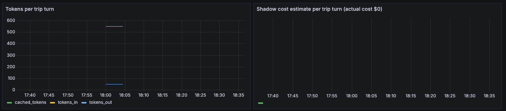
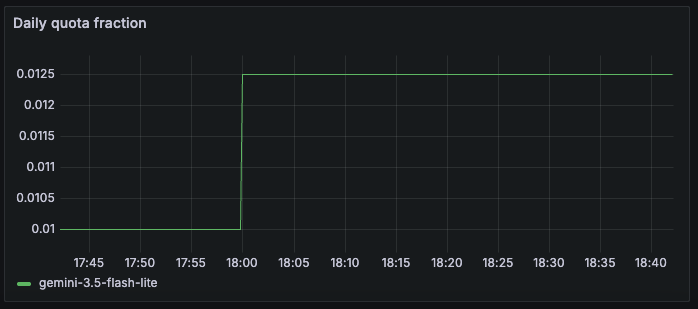
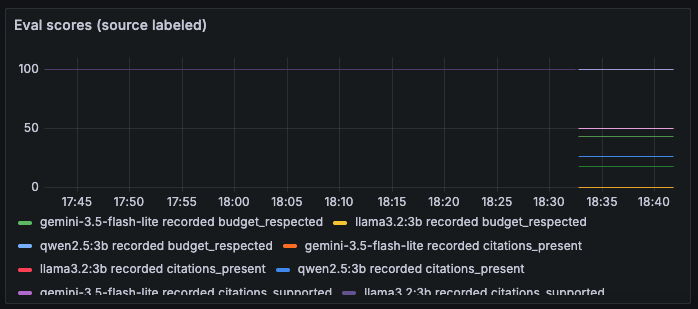
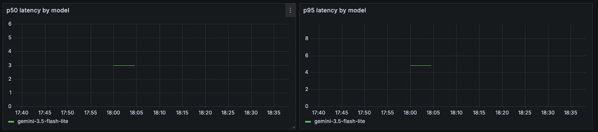
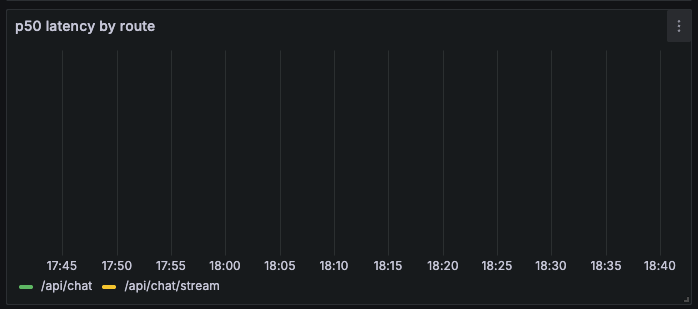
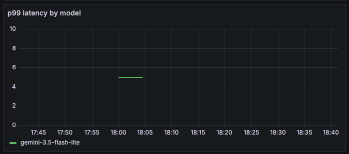
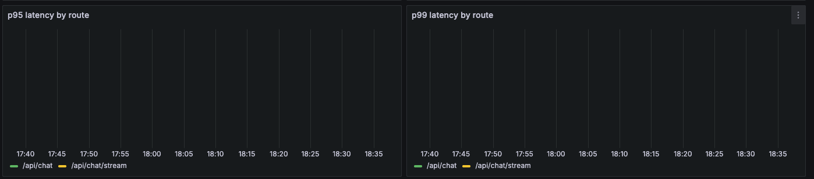

# Backend observability

The `obs` Compose profile runs Jaeger, an OpenTelemetry Collector, Prometheus,
Pushgateway and Grafana. Grafana uses host port **3002**, leaving the web app's
port 3000 available. All services run locally without paid accounts.

## Start and verify (M11)

From the repository root with the virtual environment activated:

```bash
export PYTHONPATH=.
python -m pip install -r requirements.txt
python observability/render_alerts.py
docker compose --profile obs config --quiet
docker compose --profile obs up -d jaeger collector prometheus grafana pushgateway
OTEL_EXPORTER_OTLP_ENDPOINT=http://collector:4318 docker compose up -d --build api
curl --fail http://localhost:8100/healthz
curl --fail http://localhost:8100/metrics
docker compose exec prometheus promtool check config /etc/prometheus/prometheus.yml
pytest -q tests/unit/test_observability.py
```

This preserves database volumes. Existing migrations, retrieval data and model
setup from M4/M5 still apply when making an actual planning request. Starting
these services does not call a model or download one. `OTEL_EXPORTER_OTLP_ENDPOINT`
is deliberately empty by default so the API can run without the obs profile.
For a host-run API instead, export `OTEL_EXPORTER_OTLP_ENDPOINT=http://localhost:4318`;
Prometheus's default target remains the **container** API, not the host process.

Open Grafana at http://localhost:3002 (initial local login admin/admin; change
its password when prompted). Open the **Travel / Travel LLM observability**
dashboard. Prometheus and Jaeger datasources are provisioned automatically.
Open Prometheus at http://localhost:9090/targets: `api` and `eval` should be UP.
Open Jaeger at http://localhost:16686 and select `travel-api` after a request.
`GRAFANA_PORT`, `PROMETHEUS_PORT`, `JAEGER_PORT`, `OTLP_PORT`, and
`PUSHGATEWAY_PORT` can override host ports if another project occupies them.

Send a normal request through the existing chat UI, or use the existing stream
CLI against the API. Inspect the request's trace: `agent.chat`,
`agent.context_build`, `gen_ai.chat`, `tool.*`, `retrieval.vector`,
`retrieval.fts`/`retrieval.bm25`, `retrieval.fusion`, `retrieval.rerank`,
`agent.validate_itinerary`, and `agent.repair` appear **when those paths run**.
A chitchat turn will not have retrieval/tool spans; successful first attempts
will not have repair spans. Cancellation/error spans contain error types rather
than exception payloads. No synthetic measurement is evidence of model quality.

```bash
# Push scores from an already saved eval run; no model calls.
python -m eval.push_metrics --input /tmp/eval-harness-run.json --gateway http://localhost:9091
# Alternatively, append --pushgateway http://localhost:9091 to an eval.run command.
```

Pushgateway replaces the previous `travel-evaluation` snapshot. Prometheus
records the changes over time; `source` preserves recorded versus synthetic
provenance. Synthetic rows retain the label **synthetic: tests the harness, not
a model**. No score is manufactured when no run exists. Prometheus and Grafana
have persistent volumes; Jaeger all-in-one stores traces in memory and loses
them on restart. Stop without deleting data:

```bash
docker compose --profile obs stop api jaeger collector prometheus grafana pushgateway
```

## Docker CPU runtime

The Docker build first installs the pinned CPU-only PyTorch wheel from the
[official PyTorch CPU index](https://pytorch.org/get-started/locally/) using
`requirements-docker-cpu.txt`, then the shared dependencies. This avoids the
unsupported NVIDIA SBSA wheel pulled by unconstrained PyTorch on Linux ARM.
The build runs `pip check`, imports sentence-transformers offline, and checks a
CPU tensor operation. Native host environments keep their existing PyTorch
installation. No embedding or reranking models are downloaded by this check.

## Data, metrics and limitations

FastAPI provides the HTTP server span; async tasks and worker threads inherit
its trace context. The same agent loop instruments streaming and ordinary chat.
Logical model-call spans aggregate retry count and actual fallback transitions.
They use the current [OpenTelemetry GenAI attributes](https://opentelemetry.io/docs/specs/semconv/registry/attributes/gen-ai/)
where practical: `gen_ai.provider.name`, `gen_ai.request.model`,
`gen_ai.response.model`, `gen_ai.operation.name`, `gen_ai.usage.input_tokens`,
`gen_ai.usage.output_tokens`, `gen_ai.usage.cache_read.input_tokens`, and
`gen_ai.response.finish_reasons`. Application-only fields use `travel.*`.
These GenAI conventions are evolving; this is not a claim of full compliance.

`/metrics` exposes `travel_requests_total`, request/model/tool latency
histograms, tool/model error counters, token counters, per-turn token and
shadow-cost distributions, and observed daily quota usage/limits. Metrics have
no user/trip IDs as labels, avoiding unbounded cardinality. Per-trip-turn
values and request IDs are available in traces; histograms aggregate turns.
Errors denied before entering the agent are visible in HTTP traces, not the
agent request counter. Model tokens are reported usage, not estimates of
unreported tokens on failed provider calls. Quota gauges update on model
admission, are process-local observations of the shared database counter, and
can be stale until another call; unlimited local models have no daily-limit
series. Do not sum identical quota gauges across replicas.

Shadow cost is an **estimate**, not a bill; actual cost is **$0**. It uses
`shadow_pricing_usd_per_1m_tokens` in `config/models.yaml` (input and output
rates). Missing/null prices produce no estimate and increment
`travel_shadow_cost_unknown_total`. Existing null prices are deliberately not
replaced with invented numbers. Cached tokens are already part of input tokens;
there is no additional cache discount without a configured pricing contract.

Logs are JSON with timestamp, trace/span IDs, request ID and SHA-256 user hash.
No raw user identity is logged. Hashes are pseudonymous, not anonymization.
Outside requests, correlation fields can be null or zero. Prompts and tool
arguments/results are not captured by default. `OBS_CAPTURE_PROMPTS=true`
opts into bounded, redacted prompt attributes for temporary local debugging;
regex/environment-secret redaction is not a guarantee against every sensitive
value. Keep it off for normal use, restrict access and delete debug traces.
HTTP query strings are removed from span URL attributes. Do not publicly expose
these unauthenticated local metrics/tracing endpoints.

## Alerts and optional exporter

Edit `config/observability.yaml`, then run `python observability/render_alerts.py`
and restart Prometheus. The committed `observability/alerts.yaml` contains high
chat error rate, high route p95 latency and nearly-exhausted daily-quota rules.
Thresholds are initial operator choices, not measured SLOs. Rules are evaluated
by Prometheus; external notifications require separately configured Alertmanager.
No notification service is claimed here.

Phoenix is optional and **not enabled or verified**. A separately operated local
Phoenix OTLP receiver can be selected with `OTEL_EXPORTER_OTLP_ENDPOINT`; no
Phoenix-specific SDK, hosted account or model call is required by this code.
Verify its receiver configuration before changing the endpoint. The default
verified trace destination is Jaeger through the Collector.

## Screenshot placeholders



 

 

 

 

 

 
